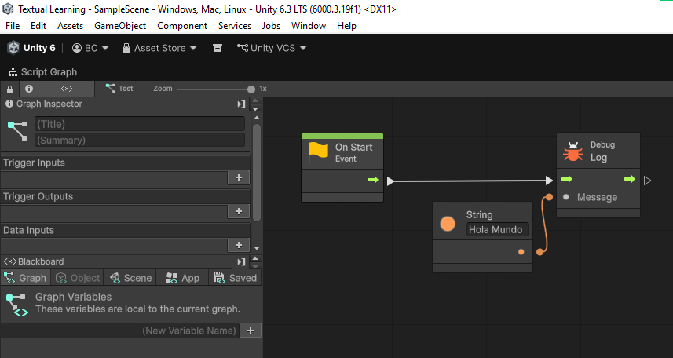

# Textual Learning

-
**Add-on for Unity** Created to teach `C#` programming syntax, this tool is specifically designed for **_college students focusing on video games using the Unity engine_**.
## Requirements and Facilities
```
Unity 6000.3 (6.3 LTS) or higher
Unity Visual Scripting
```
## How to Install
1. Open a project in Unity
2. Install Unity Visual Scripting in the project
3. Create a Graph
4. Install [Textual Learning folder](https://github.com/Dark0Glow0/Textual-Learning/tree/main/Assets/TextualLearning) in your project's asset folder

## Usage

This walkthrough uses a simple "Hello World" graph. It is assumed that you have already completed the installation guide.

### 1. Create a graph
1. Create an empty GameObject in your scene.
2. Add the **Script Machine** component to it.
3. Click **New** to create a graph and save it as an asset in your project.

### 2. Build the example
1. Open the graph with **Edit Graph**.
2. Add an **On Start** event.
3. Add a **Debug Log** node and connect On Start to it (flow connection).
4. Add a **String** node with the text `Hello World` and connect it to the `Message` input (data connection).
5. Press **Play**: "Hello World" should appear in the Console.



### 3. Open Textual Nodes
Go to **Window > Textual Learning > Textual Nodes**. A window titled "C# Textual" opens.

### 4. Load your graph
Drag your graph asset from the Project window into the **Graph** field.

### 5. Read the generated code *(coming soon)*
The window will show the C# equivalent of your graph:

```C#
using UnityEngine;

public class Test: MonoBehaviour
{
    void Start()
    {
        Debug.Log("Hello World");
    }
}
```

> **Note:** This tool is read-only. It does not modify your graph or run any code.

## Limitations

- **Read-only.** Textual Learning displays your graph as code; it does not edit the graph, and it does not run or compile anything.
- **Limited node support.** Only a small set of nodes will be translated at first (see the roadmap). Unsupported nodes will be flagged instead of silently skipped.
- **Script Graphs only.** State Graphs are not supported for now.
- **Educational focus (for now).** Textual Learning is currently developed as an educational tool, as part of a thesis project. The generated C# is meant to illustrate what a graph does and may not match line by line what Unity executes internally. Broader use, including production workflows, is a possible future direction.
- **Requires Unity Visual Scripting.** The add-on reads graphs created with that package and does not work without it.
- **Tested on Unity 6000.3 (6.3 LTS).** Other versions have not been verified.

## Roadmap

**Done**
- [x] Editor window under `Window > Textual Learning > Textual Nodes`
- [x] Graph field that only accepts Script Graph assets
- [x] The window detects when a graph is assigned or removed

**In progress**
- [ ] Read the nodes and connections inside a graph

**Planned**
- [ ] Translate the "Hello World" graph (On Start → Debug Log → String) to C#
- [ ] Read-only code panel with syntax highlighting
- [ ] Highlight the code line that corresponds to a selected node, and vice versa
- [ ] Short explanation of each node next to its code
- [ ] Support for variables, math operations, `if` and loops
- [ ] Export the generated code as a `.cs` file
- [ ] Spanish translation of this README

Ideas and suggestions are welcome: open an [issue](https://github.com/Dark0Glow0/Textual-Learning/issues).

## Credits and License

**Author:** Dark0Glow0

**Built with:**
- [Unity](https://unity.com/) by Unity Technologies
- [Unity Visual Scripting](https://docs.unity3d.com/Packages/com.unity.visualscripting@latest) (requirement, not included in this repository)

**License:** see the [LICENSE](https://github.com/Dark0Glow0/Textual-Learning/blob/main/LICENSE) file.
